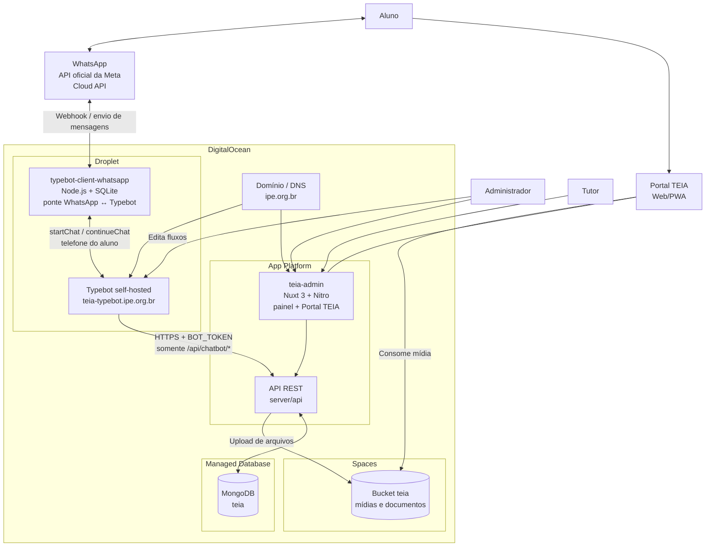
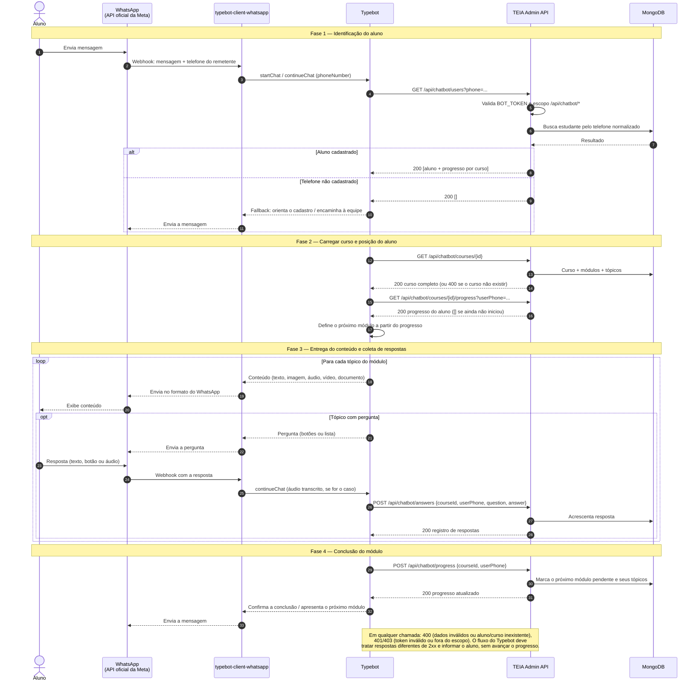

# Arquitetura da Aplicação TEIA

> Revisado em 12/11/2026.

O ecossistema TEIA tem quatro frentes:

- **TEIA Admin** (este repositório): painel administrativo, Portal TEIA (portal público do aluno) e API REST, numa única aplicação Nuxt 3.
- **Chatbot**: fluxos de conversa construídos no **Typebot** (ferramenta open source, self-hosted em `teia-typebot.ipe.org.br`) e entregues aos alunos pelo **WhatsApp**, por meio da **API oficial da Meta** (WhatsApp Business Platform / Cloud API).
- **typebot-client-whatsapp** ([repositório](https://github.com/devsdoprojetoteia/typebot-client-whatsapp)): serviço próprio, em Node.js, que faz a ponte entre a API da Meta e o Typebot. Ele recebe as mensagens dos alunos pelo webhook da Meta, repassa ao Typebot e envia as respostas de volta pelo WhatsApp, cobrindo recursos que a integração nativa do Typebot não atende (envio de vídeos, transcrição de áudio, comandos de ajuda etc.).
- **Infraestrutura** na DigitalOcean: App Platform, MongoDB gerenciado e Spaces.

## Visão de Arquitetura (Aplicação + Infraestrutura)

## Componentes Principais

| Componente | Onde roda | Responsabilidade |
|---|---|---|
| `teia-admin` | App Platform | Painel administrativo (cursos, módulos, tópicos, usuários, relatórios), Portal TEIA e API REST |
| API REST (`server/api`) | App Platform (mesmo app) | Autenticação, CRUDs, uploads, relatórios e endpoints do chatbot. Contratos em [API.md](./API.md) e [CHATBOT-API.md](../CHATBOT-API.md) |
| Portal TEIA | App Platform (mesmo app) | Páginas públicas dos cursos publicados (`/curso/[id]`), renderizadas sob demanda e instaláveis como PWA |
| Typebot | Droplet (`teia-typebot.ipe.org.br`) | Construção e execução dos fluxos de conversa |
| `typebot-client-whatsapp` | Droplet, junto com o Typebot ([repositório](https://github.com/devsdoprojetoteia/typebot-client-whatsapp)) | Ponte entre a API da Meta e o Typebot: recebe o webhook, mantém a sessão de cada aluno, repassa as mensagens ao Typebot (com o telefone do aluno) e envia as respostas (texto, imagem, vídeo, botões e listas) pelo WhatsApp |
| WhatsApp Business Platform (Meta) | Serviço da Meta | Canal com o aluno, pela API oficial (Cloud API) |
| MongoDB | Managed Database | Usuários, cursos, módulos, tópicos, progresso e respostas |
| Spaces | Object Storage | Imagens (original, miniatura e média), vídeos, áudios e documentos |

## Responsabilidades: ponte do WhatsApp × Typebot × TEIA Admin

O Typebot **não é uma LLM**: os fluxos são determinísticos, desenhados no editor visual do Typebot pela equipe. A divisão de responsabilidades é:

| Responsabilidade | typebot-client-whatsapp | Typebot | TEIA Admin (API) |
|---|---|---|---|
| Receber e enviar mensagens no WhatsApp (API da Meta) | ✅ | — | — |
| Manter a sessão de conversa de cada aluno | ✅ | ✅ | — |
| Transcrever áudios e reconhecer a opção escolhida | ✅ | — | — |
| Comandos de apoio (VOLTAR, AJUDA) | ✅ | — | — |
| Decidir o próximo passo da conversa (desvios, repetições, validação da resposta digitada) | — | ✅ | — |
| Fornecer o conteúdo do curso (módulos, tópicos, questionários) | — | — | ✅ |
| Identificar o aluno pelo telefone e validar se ele existe | — | — | ✅ |
| Persistir progresso e respostas | — | — | ✅ |
| Autenticar o bot e limitar seu acesso às rotas do chatbot | — | — | ✅ |
| Tratar falhas (fallback para o aluno) | Retentativas e aviso de erro | Caminhos de erro no fluxo | Retorna códigos de erro explícitos |

## Sequência de interação do chatbot

Cada etapa abaixo é uma chamada independente à API: o Typebot faz uma requisição por etapa e só segue para a próxima depois de receber a resposta. Não há uma chamada única que execute todas as fases.

Toda mensagem entre o aluno e o Typebot passa pelo `typebot-client-whatsapp`: na ida, ele recebe o webhook da Meta e chama o Typebot (`startChat` na primeira mensagem, `continueChat` nas seguintes, enviando o telefone do aluno na variável `phoneNumber`); na volta, ele converte as mensagens do Typebot para o formato do WhatsApp e as envia pela API da Meta.

### Guardrails do lado da API

- **Escopo do token:** o `BOT_TOKEN` só funciona em `/api/chatbot/*`; não acessa usuários, cadastros nem uploads.
- **Identificação do aluno:** progresso e respostas só são gravados para telefones de usuários existentes (400 caso contrário). Consultas com telefone inexistente retornam vazio, nunca dados de outros alunos.
- **Validação de entrada:** IDs e telefones precisam ser strings; objetos são rejeitados (proteção contra NoSQL injection).
- **Avanço controlado:** cada `POST /api/chatbot/progress` avança no máximo um módulo, sempre na ordem do curso, e não altera nada quando o curso já foi concluído.

### Fallbacks no typebot-client-whatsapp

- **Retentativas:** chamadas ao Typebot e à API da Meta são repetidas até 3 vezes, com intervalo crescente.
- **Sessão expirada:** se a sessão do aluno no Typebot expirou, o serviço inicia uma nova conversa automaticamente.
- **Aviso ao aluno:** cada mensagem recebe uma reação indicando o estado (na fila, processando, concluída ou erro), de modo que o aluno sabe quando algo falhou.
- **Comandos de apoio:** `VOLTAR` reinicia a conversa no fluxo principal; `AJUDA` envia o contato do suporte.
- **Áudio:** quando habilitada, a transcrição converte o áudio em texto e reconhece a opção escolhida; se falhar, o aluno recebe uma mensagem de erro.

### Fallbacks no Typebot

O tratamento de erros e os caminhos alternativos da conversa são configurados nos fluxos do Typebot. Para cada bloco HTTP, o fluxo deve prever o caminho de erro (resposta diferente de 2xx ou tempo esgotado) com uma mensagem ao aluno, sem avançar o progresso. A exportação dos fluxos (`.json` do Typebot) é o documento de referência dessa lógica.

## Endpoints de integração do chatbot

| Método | Rota | Uso |
|---|---|---|
| GET | `/api/chatbot/users` | Identificar o aluno pelo telefone |
| GET | `/api/chatbot/courses` | Listar cursos |
| GET | `/api/chatbot/courses/:id` | Conteúdo completo do curso |
| GET | `/api/chatbot/courses/:id/progress` | Progresso do aluno no curso |
| POST | `/api/chatbot/progress` | Concluir o próximo módulo |
| POST | `/api/chatbot/answers` | Registrar resposta do aluno |

Todos exigem `Authorization: Bearer <BOT_TOKEN>`. Detalhes em [CHATBOT-API.md](../CHATBOT-API.md).
