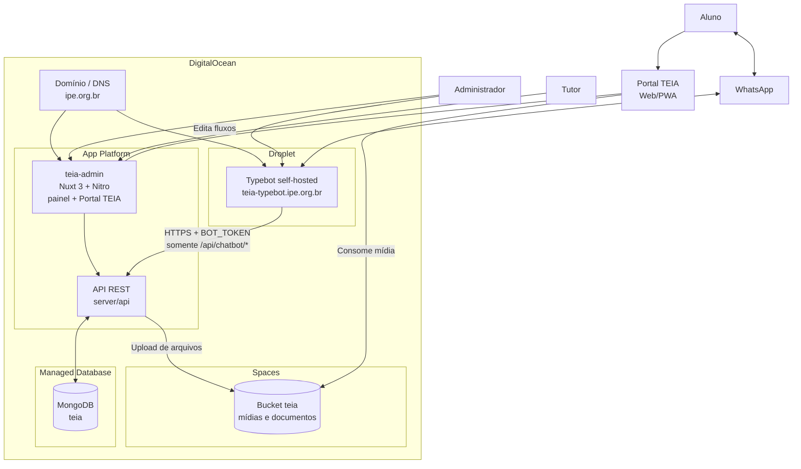
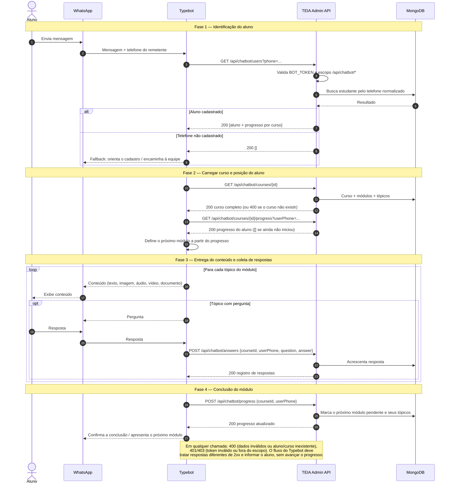

# Arquitetura da Aplicação TEIA

> Revisado em 14/10/2026.

O ecossistema TEIA tem três frentes:

- **TEIA Admin** (este repositório): painel administrativo, Portal TEIA (portal público do aluno) e API REST, numa única aplicação Nuxt 3.
- **Chatbot**: fluxos de conversa construídos no **Typebot** (ferramenta open source, self-hosted em `teia-typebot.ipe.org.br`) e entregues aos alunos pelo **WhatsApp**.
- **Infraestrutura** na DigitalOcean: App Platform, MongoDB gerenciado e Spaces.

## Visão de Arquitetura (Aplicação + Infraestrutura)

## Componentes Principais

| Componente | Onde roda | Responsabilidade |
|---|---|---|
| `teia-admin` | App Platform | Painel administrativo (cursos, módulos, tópicos, usuários, relatórios), Portal TEIA e API REST |
| API REST (`server/api`) | App Platform (mesmo app) | Autenticação, CRUDs, uploads, relatórios e endpoints do chatbot. Contratos em [API.md](./API.md) e [CHATBOT-API.md](../CHATBOT-API.md) |
| Portal TEIA | App Platform (mesmo app) | Páginas públicas dos cursos publicados (`/curso/[id]`), renderizadas sob demanda e instaláveis como PWA |
| Typebot | Droplet (`teia-typebot.ipe.org.br`) | Construção e execução dos fluxos de conversa; integração com o WhatsApp |
| MongoDB | Managed Database | Usuários, cursos, módulos, tópicos, progresso e respostas |
| Spaces | Object Storage | Imagens (original, miniatura e média), vídeos, áudios e documentos |

## Responsabilidades: Typebot × TEIA Admin

O Typebot **não é uma LLM**: os fluxos são determinísticos, desenhados no editor visual do Typebot pela equipe. A divisão de responsabilidades é:

| Responsabilidade | Typebot | TEIA Admin (API) |
|---|---|---|
| Enviar mensagens, mídias e perguntas ao aluno | ✅ | — |
| Decidir o próximo passo da conversa (desvios, repetições, validação da resposta digitada) | ✅ | — |
| Fornecer o conteúdo do curso (módulos, tópicos, questionários) | — | ✅ |
| Identificar o aluno pelo telefone e validar se ele existe | — | ✅ |
| Persistir progresso e respostas | — | ✅ |
| Autenticar o bot e limitar seu acesso às rotas do chatbot | — | ✅ |
| Tratar falhas da API (fallback para o aluno) | ✅ | Retorna códigos de erro explícitos |

## Sequência de interação do chatbot

Cada etapa abaixo é uma chamada independente à API: o Typebot faz uma requisição por etapa e só segue para a próxima depois de receber a resposta. Não há uma chamada única que execute todas as fases.

### Guardrails do lado da API

- **Escopo do token:** o `BOT_TOKEN` só funciona em `/api/chatbot/*`; não acessa usuários, cadastros nem uploads.
- **Identificação do aluno:** progresso e respostas só são gravados para telefones de usuários existentes (400 caso contrário). Consultas com telefone inexistente retornam vazio, nunca dados de outros alunos.
- **Validação de entrada:** IDs e telefones precisam ser strings; objetos são rejeitados (proteção contra NoSQL injection).
- **Avanço controlado:** cada `POST /api/chatbot/progress` avança no máximo um módulo, sempre na ordem do curso, e não altera nada quando o curso já foi concluído.

### Fallbacks no Typebot

O tratamento de erros e os caminhos alternativos da conversa são configurados nos fluxos do Typebot. Para cada bloco HTTP, o fluxo deve prever o caminho de erro (resposta diferente de 2xx ou tempo esgotado) com uma mensagem ao aluno, sem avançar o progresso. A exportação dos fluxos (`.json` do Typebot) é o documento de referência dessa lógica.

## Endpoints de integração do chatbot

| Método | Rota | Uso |
|---|---|---|
| GET | `/api/chatbot/users` | Identificar o aluno pelo telefone |
| GET | `/api/chatbot/courses` | Listar cursos |
| GET | `/api/chatbot/courses/:id` | Conteúdo completo do curso |
| GET | `/api/chatbot/courses/:id/progress` | Progresso do aluno no curso |
| POST | `/api/chatbot/progress` | Concluir o próximo módulo |
| POST | `/api/chatbot/answers` | Registrar resposta do aluno |

Todos exigem `Authorization: Bearer <BOT_TOKEN>`. Detalhes em [CHATBOT-API.md](../CHATBOT-API.md).
